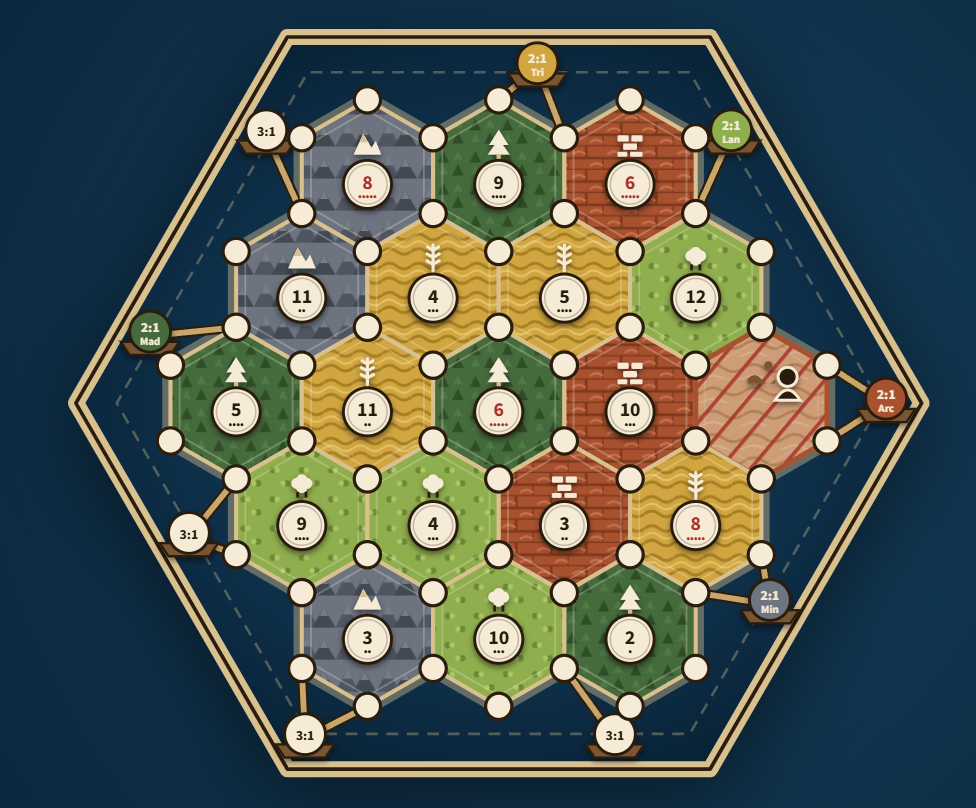
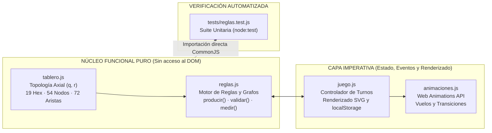
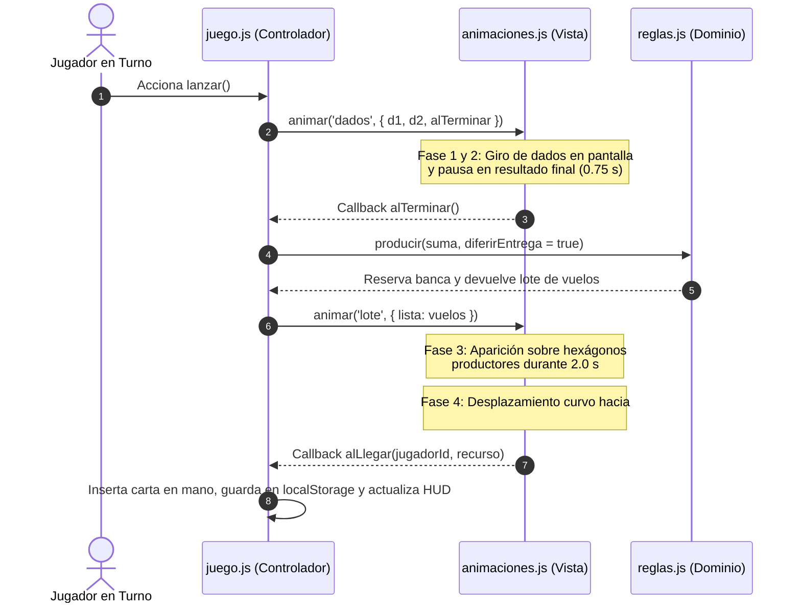

<div align="center">

# CATÁN Web



**Implementación web de Catán (5.ª Edición) con tablero SVG, arquitectura axial y motor de reglas desacoplado.**

<br />

<a href="https://geuguis.github.io/CATAN-Web/">
  
</a>

<br /><br />

[](https://github.com/geuguis/CATAN-Web/actions)
[](./package.json)
[](./LICENSE.txt)

> [!NOTE]
> **Aviso legal**: Proyecto de fans, sin afiliación con Catan GmbH ni Devir/Kosmos. La marca CATAN y las reglas originales son propiedad de sus respectivos titulares. La licencia MIT cubre únicamente el código fuente del proyecto. El manual oficial de reglas puede consultarse en [catan.com](https://www.catan.com/understand-catan/game-rules).

<p align="center">
  <a href="#como-jugar"><strong>Cómo Jugar</strong></a>
  &nbsp;&middot;&nbsp;
  <a href="#arquitectura">Arquitectura</a>
  &nbsp;&middot;&nbsp;
  <a href="#geometria">Geometría y Grafos</a>
  &nbsp;&middot;&nbsp;
  <a href="#protocolo">Protocolo Hot-Seat</a>
  &nbsp;&middot;&nbsp;
  <a href="#reglas">Reglas</a>
  &nbsp;&middot;&nbsp;
  <a href="#pruebas">Pruebas</a>
</p>

</div>

---

<a id="como-jugar"></a>
## Acceso Directo — Cómo Jugar

> [!IMPORTANT]
> **Juega directamente desde el navegador sin instalar nada a través de este enlace:**
> ### [https://geuguis.github.io/CATAN-Web/](https://geuguis.github.io/CATAN-Web/)

---

## Sinopsis Técnica

**Catán Web** es una implementación íntegra del juego de mesa *CATÁN* (5.ª Edición) construida desde cero sobre el estándar web nativo (**HTML5, CSS3, SVG dinámico y JavaScript ES6+**) sin motores gráficos ni librerías externas.

| Métrica del Sistema | Especificación | Implementación |
| :--- | :--- | :--- |
| **Patrón Arquitectónico** | *Functional Core / Imperative Shell* | Dominio puro en [`reglas.js`](./reglas.js) desacoplado del DOM en [`juego.js`](./juego.js) |
| **Topología del Tablero** | Grafo planar generado por coordenadas axiales $(q, r)$ | 19 hexágonos, 54 nodos, 72 aristas y 9 puertos calculados en [`tablero.js`](./tablero.js) |
| **Modalidad de Juego** | Local *Pass & Play* (3 a 4 jugadores en un mismo equipo) | Cartas cubiertas por defecto y protocolo de reordenación ante robo |
| **Persistencia y Seguridad** | Serialización automática y sanitización de entrada | Estado en `localStorage` (`guardar`/`cargar`) y escape HTML (`escapar`) |
| **Verificación** | Suite determinista sin navegador (*headless*) | 6 casos de prueba con `node:test` en [`tests/reglas.test.js`](./tests/reglas.test.js) |

---

<a id="arquitectura"></a>
## 01 // Arquitectura del Sistema

El código fuente se divide en cuatro módulos independientes que separan el modelo matemático y las reglas de negocio de la capa de presentación en el DOM:



### Distribución de Módulos

| Archivo | Capa | Responsabilidad Principal | Símbolos Clave |
| :--- | :--- | :--- | :--- |
| [`tablero.js`](./tablero.js) | Modelo Topológico | Proyección de coordenadas axiales a cartesianas, deducción de vértices/aristas compartidas y distribución con restricción de adyacencia. | `generar`, `distribuir`, `barajar` |
| [`reglas.js`](./reglas.js) | Dominio Puro | Validación de construcción, reparto con escasez de banca, tarifas portuarias y búsqueda en profundidad (DFS) de la Gran Ruta Comercial. | `producir`, `validar`, `medir`, `evaluar`, `tasar`, `puntuar` |
| [`animaciones.js`](./animaciones.js) | Vista Dinámica | Interpolación de trayectorias entre coordenadas del SVG y elementos del HUD mediante `Element.prototype.animate`. | `animar`, `ubicar` |
| [`juego.js`](./juego.js) | Controlador / UI | Gestión de máquina de estados del turno, eventos de usuario, sanitización XSS (`escapar`), soporte táctil (`voltear`) y persistencia en `localStorage`. | `lanzar`, `construir`, `comerciar`, `robar`, `ordenar`, `dibujar`, `guardar` |
| [`tests/reglas.test.js`](./tests/reglas.test.js) | Calidad (QA) | Pruebas deterministas sobre grafos, bloqueos de ruta, puertos marítimos y agotamiento de recursos en la banca. | `crearEstadoPrueba` + 5 suites |

---

<a id="geometria"></a>
## 02 // Geometría Axial y Algoritmos

### Generación Topológica del Tablero

En lugar de codificar manualmente las conexiones entre las 54 intersecciones y los 72 caminos de la isla, [`generar`](./tablero.js) construye el grafo completo en tiempo de ejecución a partir de las 19 coordenadas axiales $(q, r)$ de un hexágono regular de radio $R = 52$:

$$x_c = R\sqrt{3}\left(q + \frac{r}{2}\right), \qquad y_c = \frac{3}{2}R \cdot r$$

Para cada centro $(x_c, y_c)$, se calculan sus 6 vértices con ángulos $\theta_i = 60^\circ i - 30^\circ$ y se indexan en una tabla hash espacial (`mapaNodos`) redondeando al píxel entero más próximo. De este modo, las intersecciones y aristas compartidas entre hasta 3 hexágonos emergen de forma exacta sin duplicidad de nodos.

<details>
<summary><strong>Desplegar análisis matemático: Restricción de números rojos (6 y 8) y algoritmo DFS de Gran Ruta Comercial</strong></summary>
<br />

#### 1. Distribución equilibrada (`distribuir` en `tablero.js`)
En el modo **Mapa Variable**, las 18 fichas numeradas se asignan asegurando que ningún hexágono con número `6` u `8` (probabilidad $5/36$) comparta arista con otro `6` u `8`. La distancia axial entre dos hexágonos $(q_1, r_1)$ y $(q_2, r_2)$ se evalúa como:

$$d = \max\left(|q_1 - q_2|,\; |r_1 - r_2|,\; |(q_1 + r_1) - (q_2 + r_2)|\right) > 1$$

#### 2. Cálculo de la Gran Ruta Comercial (`medir` en `reglas.js`)
El cálculo del camino simple más largo de aristas es un problema sobre un grafo no dirigido que puede contener ciclos hexagonales y bifurcaciones. Dado que cada jugador dispone de un máximo de $E \le 15$ carreteras en su reserva, `medir` ejecuta una búsqueda en profundidad (**DFS con backtracking**) desde cada extremo de arista propia:

- Marca cada carretera recorrida en un conjunto temporal `usados` para impedir reutilizar aristas en ciclos.
- Corta inmediatamente la exploración de una rama si el vértice intermedio contiene un poblado o ciudad perteneciente a otro jugador (`nodo.dueno !== null && nodo.dueno !== jugadorId`), cumpliendo la regla oficial de interrupción de ruta.

</details>

---

<a id="protocolo"></a>
## 03 // Flujos de Interacción y Privacidad

### Secuencia Sincronizada de Producción

Para evitar que los contadores de recursos se actualicen antes de que el jugador vea el resultado de los dados, la tirada ejecuta una tubería asíncrona de cuatro fases encadenadas por callbacks (`alLlegar` y `alTerminar`):



### Protocolo de Defensa ante el Ladrón (*Hot-Seat*)

Cuando un jugador obtiene un `7` o juega una carta de **Caballero** y desplaza al ladrón hacia un hexágono con rivales adyacentes:

1. **Selección de objetivo**: si hay varios jugadores edificados en torno al hexágono bloqueado, el atacante elige a cuál robar.
2. **Fase de defensa privada (`ordenar`)**: antes de que se efectúe el robo, el turno visual pasa temporalmente a la víctima, quien puede inspeccionar sus propias cartas, desplazarlas de posición (`◄` / `►`) o barajarlas al azar (`Mezclar al Azar`) y finalmente pulsar `Tapar Cartas para el Robo`.
3. **Extracción a ciegas (`robar`)**: el jugador activo visualiza únicamente el reverso de las cartas ya reordenadas, selecciona una posición, se revela el recurso obtenido y la carta vuela hacia su insignia de perfil.

---

<a id="reglas"></a>
## 04 // Especificación de Reglas

| Ámbito del Reglamento | Implementación en el Motor | Referencia en Código |
| :--- | :--- | :--- |
| **Configuración de Jugadores** | Mesa configurable para **3 jugadores** por defecto con ampliación opcional a **4 jugadores**. Orden de colocación inicial en serpiente ($1 \to N \to 1$). | [`cambiarCantidad`](./juego.js), [`reiniciar`](./juego.js) |
| **Escasez de la Banca** | Stock estricto de 19 cartas por materia prima. Si la demanda conjunta de una tirada supera la reserva de la banca para varios jugadores, ninguno recibe ese recurso; si hay un único beneficiario, recibe el remanente. | [`producir`](./reglas.js) |
| **Regla de la Distancia** | Prohibición de edificar poblados en cualquier intersección conectada por una arista a otro poblado o ciudad existente (propio o rival). | [`validar`](./reglas.js) |
| **Comercio Naval en Puertos** | El comercio marítimo requiere poseer al menos un poblado o ciudad edificado sobre los nodos costeros de un puerto (`3:1` genérico o `2:1` especializado). Sin edificio portuario, la acción permanece bloqueada. | [`puertosJugador`](./reglas.js), [`tasar`](./reglas.js) |
| **Comercio entre Jugadores** | Intercambio directo con el jugador en turno. Se bloquea el botón de decremento (`-`) cuando el contador es `0`, se impiden entregas vacías (regalos) y se prohíbe intercambiar el mismo tipo de recurso en ambos sentidos. | [`comerciar`](./juego.js) |
| **Mazo de Desarrollo** | 25 cartas exactas (14 Caballeros, 2 Carreteras, 2 Año de la Abundancia, 2 Monopolio, 5 Puntos de Victoria). Restricción de uso de 1 carta por turno y bloqueo de uso en el mismo turno de compra (salvo Puntos de Victoria al llegar a 10 PV). | [`comprar`](./juego.js), [`usar`](./juego.js) |
| **Cierre Anticipado y Desempate** | Victoria automática al alcanzar 10 PV en turno propio. Si se finaliza manualmente la partida desde el menú de pausa (`Terminar Partida Ahora`) y existe empate en cabeza, se ejecuta un **Duelo de Dados por Desempate**. | [`ganar`](./juego.js), [`terminar`](./juego.js), [`desempatar`](./juego.js) |

> [!NOTE]
> **Persistencia y Dispositivos Táctiles**: El estado completo de la partida se serializa automáticamente en `localStorage` tras cada acción (`catan_partida_local_v1`), permitiendo reanudar la sesión desde la pantalla inicial en caso de recarga del navegador. En pantallas táctiles sin soporte para `:hover`, las cartas del atril pueden pulsarse individualmente para alternar su visualización.

---

<a id="pruebas"></a>
## 05 // Verificación y Desarrollo Local

### Opción 1: Jugar Online (Recomendado)

Juega directamente desde este enlace sin necesidad de clonar ni instalar nada:
**[https://geuguis.github.io/CATAN-Web/](https://geuguis.github.io/CATAN-Web/)**

### Opción 2: Ejecución Local

El proyecto no requiere transpilación ni empaquetadores. Clona el repositorio y abre [`index.html`](./index.html) en cualquier navegador moderno:

```bash
git clone https://github.com/geuguis/CATAN-Web.git
cd CATAN-Web
```

### Suite de Pruebas Unitarias

Para ejecutar la batería de pruebas sobre el motor de reglas (requiere Node.js 18+):

```bash
npm test
```

```text
✔ generar construye 19 hexagonos, 54 nodos, 72 caminos y 9 puertos sin 6 ni 8 adyacentes
✔ validar aplica la Regla de la Distancia y exige conexion a carretera propia
✔ producir respeta la regla oficial de escasez de la banca
✔ medir y evaluar calculan la Gran Ruta Comercial, cortes rivales y empates
✔ tasar exige tener poblado o ciudad en un puerto para habilitar el comercio naval
✔ miniaturaSVG rapido coloca 6 poblados respetando siempre la Regla de la Distancia
ℹ tests 6 | pass 6 | fail 0
```

---

## Estructura del Proyecto

```text
CATAN-Web/
├── .github/workflows/tests.yml      # Pipeline de integración continua (GitHub Actions)
├── fonts/                           # Tipografías locales sin dependencias externas
│   ├── fraunces-bold.woff2          # Títulos y fichas de tablero
│   └── source-sans.woff2            # Textos y cuerpo de interfaz
├── tests/reglas.test.js             # Suite de pruebas unitarias (node:test)
├── index.html                       # Menú con isla integrada, modales y tablero SVG
├── estilos.css                      # Paleta de juego, texturas y diseño responsive
├── tablero.js                       # Generador topológico axial (19 hex, 54 nodos, 72 aristas, miniaturas)
├── reglas.js                        # Motor puro de reglas (producción, escasez, distancia, DFS)
├── animaciones.js                   # Sistema de trayectorias, dados y transiciones (Web Animations API)
├── juego.js                         # Controlador de turnos, renderizado SVG y persistencia
├── package.json                     # Definición del script de pruebas
└── README.md                        # Documentación técnica del sistema
```

---

<div align="center">
  <sub>Distribuido bajo la Licencia MIT. Consulta <a href="./LICENSE.txt">LICENSE.txt</a> para más detalles.</sub>
</div>
